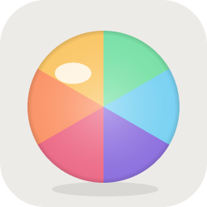
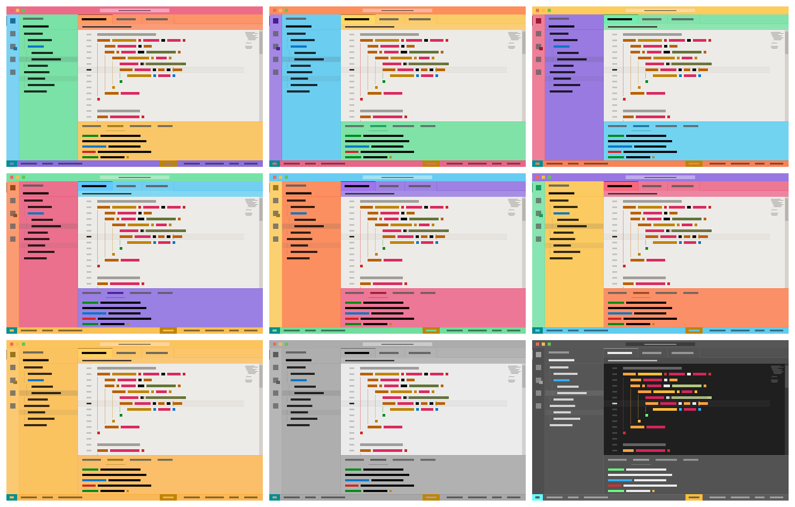

# Soap Bubble

[English](#english) | [日本語](#日本語)



---

## English

Nine vivid themes for VS Code whose **frame is a rainbow**. In the six rainbow themes the title bar, tab strip,
panel, side bar, activity bar and status bar each take one of six colors (red, orange, yellow, green, blue,
violet) around an off-white editor. The six use the same colors in the same order; each one shifts them one
zone along, and is named after the color of its title bar. Three single-color variants — Gold, Grayscale Light
and Grayscale Dark — paint the whole frame with one color instead.

They are made for the window you only *read* in: production code, a vendored library, somebody else's
repository. A window this loud is never mistaken for the one you edit in, and with six to choose from, each
read-only window can have its own.



### Variants

The colors travel through the zones in this order: title bar → tab strip → panel → side bar → activity bar →
status bar. Each theme is the previous one shifted by one.

| Theme | Title bar | Tab strip | Panel | Side bar | Activity bar | Status bar |
|---|---|---|---|---|---|---|
| Soap Bubble: Red | Red | Orange | Yellow | Green | Blue | Violet |
| Soap Bubble: Orange | Orange | Yellow | Green | Blue | Violet | Red |
| Soap Bubble: Yellow | Yellow | Green | Blue | Violet | Red | Orange |
| Soap Bubble: Green | Green | Blue | Violet | Red | Orange | Yellow |
| Soap Bubble: Blue | Blue | Violet | Red | Orange | Yellow | Green |
| Soap Bubble: Violet | Violet | Red | Orange | Yellow | Green | Blue |

Individual previews: [Red](images/preview-red.png) · [Orange](images/preview-orange.png) ·
[Yellow](images/preview-yellow.png) · [Green](images/preview-green.png) · [Blue](images/preview-blue.png) ·
[Violet](images/preview-violet.png)

The panel (terminal, problems, output) comes right after the tab strip in the order, so that when it is docked
on the right the frame reads title → tabs → panel → side bar clockwise. The secondary side bar shares the side
bar's colors; VS Code has no separate color keys for it.

Three single-color variants paint every frame zone with the same color, for when a rainbow is one bubble too
many:

- **Soap Bubble: Gold** — a gold frame around the same off-white editor ([preview](images/preview-gold.png))
- **Soap Bubble: Grayscale Light** — the frame and editor in grays; the syntax colors, brackets and indent
  guides keep their colors ([preview](images/preview-grayscale-light.png))
- **Soap Bubble: Grayscale Dark** — the grayscale theme with its lightness flipped: a dark theme with a gray
  frame ([preview](images/preview-grayscale-dark.png))

### Install

From VS Code, open the Extensions view (`Cmd+Shift+X` / `Ctrl+Shift+X`), search for **Soap Bubble**, and
install. Or run this from the Command Palette:

```
ext install tinklingway.soap-bubble
```

Then pick a theme with **Preferences: Color Theme** (`Cmd+K Cmd+T` / `Ctrl+K Ctrl+T`) and choose any
**Soap Bubble: …** entry.

To install from a `.vsix` file instead, use **Extensions: Install from VSIX…** in the Command Palette, or
`code --install-extension soap-bubble-0.0.2.vsix`.

### Using it as the "production" window

The theme is a signal, not a lock. To make the window truly read-only too, give the production checkout its own
workspace settings (`.vscode/settings.json` in that folder, or a `.code-workspace` file):

```jsonc
{
  "workbench.colorTheme": "Soap Bubble: Red",
  "files.readonlyInclude": { "**": true },
  "window.title": "🌈 READ ONLY · ${rootName} · ${activeEditorShort}"
}
```

`files.readonlyInclude` makes every file in that workspace read-only in the editor (VS Code 1.79+). The theme and
title setting are per-workspace, so your other windows keep their own theme. Give each read-only checkout a
different variant and you can tell them apart by the title bar.

### How the colors work

The frame is vivid; the editor is calm. The editor in the middle is a warm off-white (`#edebe8`) with the same
syntax colors in all six themes: amber keywords, blue functions, green strings, purple types, crimson variables,
red constants and errors, orange numbers, magenta parameters, teal declarations, gray italic comments. So an
error is red whichever bubble you pick.

Inside the editor the rainbow continues in two places: **bracket pairs** (`editorBracketHighlight.foreground1`–`6`)
and **indent guides** (`editorIndentGuide.background1`–`6`), both in red, orange, amber, green, blue and purple,
one per nesting level.

If you want to change a color, the zone order, or the vividness, see [DEVELOPMENT.md](DEVELOPMENT.md).

### Credits and license

Soap Bubble is released under the **GNU General Public License v3.0**. See [LICENSE](LICENSE).

It is a sibling of [Soap Dish](https://github.com/tinkling-way-apps/soap-dish-theme) (nine pastel light themes,
one hue each) and starts from a copy of Soap Dish Purple. Soap Dish in turn is a derivative work of
[Bearded Theme](https://github.com/BeardedBear/bearded-theme) by BeardedBear
([Marketplace](https://marketplace.visualstudio.com/items?itemName=BeardedBear.beardedtheme)), which is licensed
under GPL-3.0: the workbench palette, syntax palette and TextMate scope mapping come from Bearded Theme Milkshake
Blueberry. Credit for the underlying design belongs to BeardedBear; the zone-wise hue rotation, the six shifts,
the rainbow bracket and guide colors, the icon, the previews and the documentation are additions made here.

Copyright (C) 2026 TinklingWay. Bearded Theme is Copyright (C) BeardedBear.

---

## 日本語

**枠が虹**の、鮮やかな VS Code テーマ 9 本。虹の 6 テーマでは、タイトルバー・タブ列・パネル・サイドバー・アクティビティバー・
ステータスバーが 6 色(赤・橙・黄・緑・青・紫)を 1 つずつ受け持ち、灰白のエディタを囲む。6 テーマは同じ色を同じ順で使い、
1 テーマごとに色が領域を 1 つずつずれる。名前はタイトルバーの色。単色のバリエーション 3 本(Gold・Grayscale Light・
Grayscale Dark)は、枠全体を 1 色で塗る。

本番コード・取り込んだライブラリ・他人のリポジトリなど、**読むだけの窓**に当てるためのもの。これだけ派手なら、
普段編集している窓と見間違えようがない。6 色あるので、読むだけの窓が複数あってもそれぞれに別の色を当てられる。


### バリエーション

色が巡る順は、タイトルバー → タブ列 → パネル → サイドバー → アクティビティバー → ステータスバー。各テーマは前のテーマを
1 つずらしたもの。

| テーマ名 | タイトルバー | タブ列 | パネル | サイドバー | アクティビティバー | ステータスバー |
|---|---|---|---|---|---|---|
| Soap Bubble: Red | 赤 | 橙 | 黄 | 緑 | 青 | 紫 |
| Soap Bubble: Orange | 橙 | 黄 | 緑 | 青 | 紫 | 赤 |
| Soap Bubble: Yellow | 黄 | 緑 | 青 | 紫 | 赤 | 橙 |
| Soap Bubble: Green | 緑 | 青 | 紫 | 赤 | 橙 | 黄 |
| Soap Bubble: Blue | 青 | 紫 | 赤 | 橙 | 黄 | 緑 |
| Soap Bubble: Violet | 紫 | 赤 | 橙 | 黄 | 緑 | 青 |

個別のプレビュー: [Red](images/preview-red.png) · [Orange](images/preview-orange.png) ·
[Yellow](images/preview-yellow.png) · [Green](images/preview-green.png) · [Blue](images/preview-blue.png) ·
[Violet](images/preview-violet.png)

パネル(ターミナル・問題・出力)をタブ列の次に置いているのは、右に寄せて使うとき枠が タイトル → タブ → パネル → サイドバー と
時計回りに読めるようにするため。セカンダリサイドバーはサイドバーと色を共有する(VS Code に専用の色キーが無い)。

虹では泡が多すぎるときのために、枠の全領域を同じ 1 色で塗る単色のバリエーションが 3 本ある。

- **Soap Bubble: Gold** — 同じ灰白のエディタを金の枠で囲む([プレビュー](images/preview-gold.png))
- **Soap Bubble: Grayscale Light** — 枠もエディタも灰色。構文色・括弧・インデントガイドの色はそのまま
  ([プレビュー](images/preview-grayscale-light.png))
- **Soap Bubble: Grayscale Dark** — Grayscale の明度を反転したもの。灰色の枠のダークテーマ
  ([プレビュー](images/preview-grayscale-dark.png))

### インストール

VS Code の拡張機能ビュー(`Cmd+Shift+X` / `Ctrl+Shift+X`)で **Soap Bubble** を検索してインストールする。コマンドパレットから
次を実行してもよい。

```
ext install tinklingway.soap-bubble
```

そのあと **基本設定: 配色テーマ**(`Cmd+K Cmd+T` / `Ctrl+K Ctrl+T`)で **Soap Bubble: 〜** のどれかを選ぶ。

`.vsix` ファイルから入れる場合は、コマンドパレットの **拡張機能: VSIX からのインストール…** か、
`code --install-extension soap-bubble-0.0.2.vsix` を使う。

### 「本番の窓」として使う

テーマは目印であって鍵ではない。窓そのものも読み取り専用にするには、本番のチェックアウトにワークスペース設定
(そのフォルダの `.vscode/settings.json`、または `.code-workspace` ファイル)を持たせる。

```jsonc
{
  "workbench.colorTheme": "Soap Bubble: Red",
  "files.readonlyInclude": { "**": true },
  "window.title": "🌈 READ ONLY · ${rootName} · ${activeEditorShort}"
}
```

`files.readonlyInclude` でそのワークスペースの全ファイルがエディタ上で読み取り専用になる(VS Code 1.79 以降)。
テーマとタイトルの設定はワークスペース単位なので、他の窓はそれぞれのテーマのまま。読むだけのチェックアウトごとに
別のバリエーションを当てれば、タイトルバーの色で見分けがつく。

### 配色の考え方

枠は派手に、エディタは静かに。真ん中のエディタは暖かみのある灰白(`#edebe8`)で、構文色は 6 テーマ共通。琥珀のキーワード、
青の関数、緑の文字列、紫の型、紅の変数、赤の定数とエラー、橙の数値、マゼンタの引数、ティールの宣言、灰の斜体コメント。
どの泡を選んでもエラーは赤のまま。

エディタの中でも虹は 2 か所に続く。**括弧の対**(`editorBracketHighlight.foreground1`〜`6`)と
**インデントガイド**(`editorIndentGuide.background1`〜`6`)で、どちらも赤・橙・琥珀・緑・青・紫を入れ子の深さごとに当てている。

色や領域の順、派手さを変えたいときは [DEVELOPMENT.md](DEVELOPMENT.md) を参照。

### 出典とライセンス

Soap Bubble は **GNU General Public License v3.0** で公開する。全文は [LICENSE](LICENSE)。

[Soap Dish](https://github.com/tinkling-way-apps/soap-dish-theme)(1 色につき 1 色相のパステルのライトテーマ 9 色)の姉妹作で、
Soap Dish Purple の写しから始めている。Soap Dish は BeardedBear 作
[Bearded Theme](https://github.com/BeardedBear/bearded-theme)([Marketplace](https://marketplace.visualstudio.com/items?itemName=BeardedBear.beardedtheme)、GPL-3.0)の
派生物にあたり、ワークベンチの配色・構文の配色・TextMate スコープの割り当ては Bearded Theme Milkshake Blueberry に由来する。
土台となる設計の功績は BeardedBear にあり、領域ごとの色相回転、6 つのずらし、括弧とガイドの虹色、アイコン、プレビュー、
ドキュメントがここで加えたもの。

Copyright (C) 2026 TinklingWay。Bearded Theme は Copyright (C) BeardedBear。
